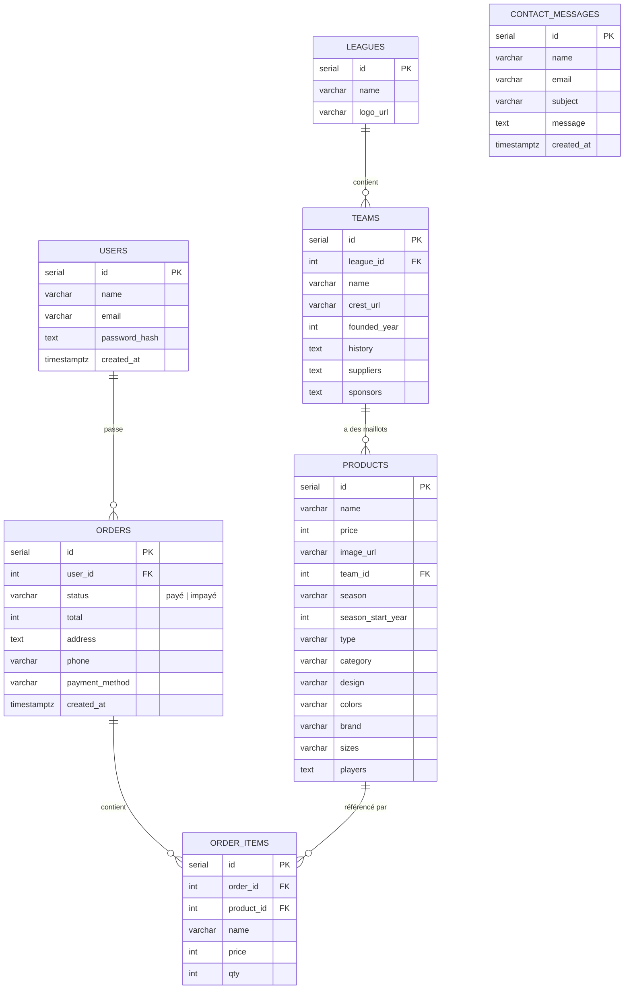

# Base de données

PostgreSQL, schéma cumulatif dans `backend/src/schema.sql` (que des
`CREATE TABLE IF NOT EXISTS` / `ALTER TABLE ... ADD COLUMN IF NOT EXISTS`,
donc rejouable sans casser une base existante — pas d'outil de migration
dédié type Knex/Prisma, c'est un seul fichier SQL idempotent).

## Notes sur les tables

- **`products.category`** — valeurs utilisées : `Maillots` (défaut),
  `Avant-match`, `Entraînement`, `Voyage`, et `Archive historique` pour les
  entrées placeholder du timeline historique (pas d'image réelle, pas de prix
  ni bouton d'achat). Voir [[Politique-de-donnees]].
- **`products.team_id`** est nullable (`ON DELETE SET NULL`) : une commande
  passée reste lisible même si un produit est supprimé plus tard.
- **`products.season_start_year`** pilote le tri chronologique des maillots
  d'une équipe (`ORDER BY category, season_start_year DESC NULLS LAST` dans
  `teams.routes.js`). Un produit réel sans cette valeur remonte *après* les
  placeholders d'archive — bug déjà rencontré et corrigé une fois (voir
  [[Etat-du-depot]] pour l'historique des bugs de ce type).
- **`orders.status`** est contraint par un `CHECK` SQL à seulement deux
  valeurs : `'payé'` ou `'impayé'` — pas d'états intermédiaires.
- **`products.league`** (colonne `VARCHAR` ajoutée avant `team_id`/`teams`)
  est un reliquat de la première version du catalogue (avant la
  normalisation championnat→équipe→maillot) ; la donnée de championnat passe
  maintenant par `products.team_id → teams.league_id → leagues`.

## Connexion

`backend/src/db.js` lit `DB_HOST`, `DB_PORT`, `DB_USER`, `DB_PASSWORD`,
`DB_NAME` depuis `backend/.env` (fichier non versionné, voir
[[Etat-du-depot]]) pour construire un `pg.Pool`.
